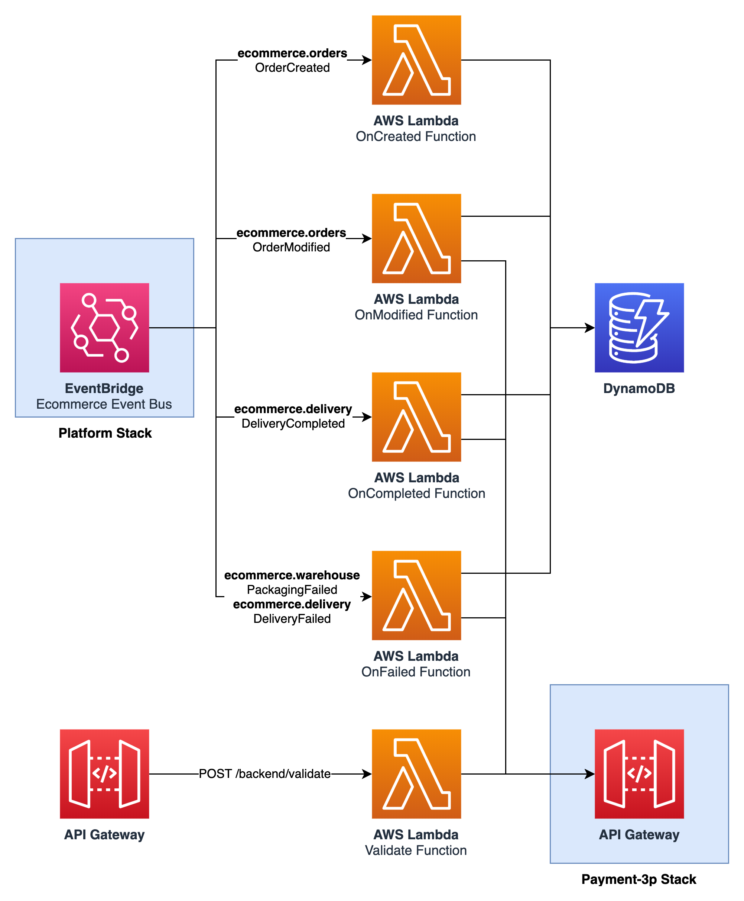
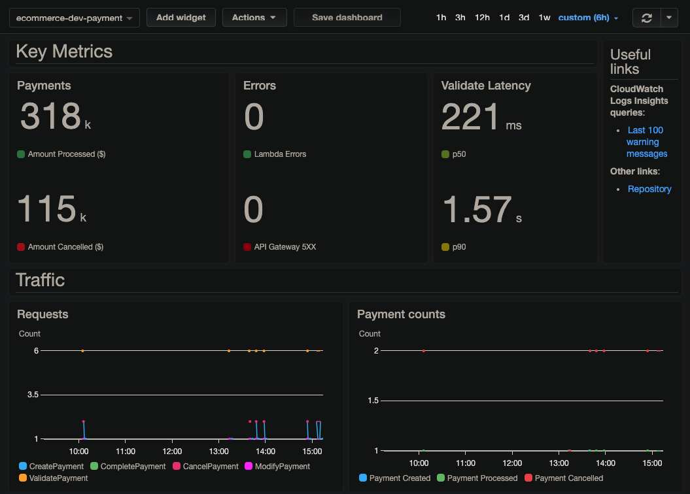

# ACME Shop: Payment

Authorises, captures and cancels customer payments through the payment service provider, following the order lifecycle.

- Component: `payment` (service, production)
- Owner: **payments-team**
- System: `payments`

## Origin and license

This repository is derived from [aws-samples/aws-serverless-ecommerce-platform](https://github.com/aws-samples/aws-serverless-ecommerce-platform) at commit [`3b9ef36`](https://github.com/aws-samples/aws-serverless-ecommerce-platform/tree/3b9ef36dd3e338c8ab697c2bcb1b672e064e303c), split out of that monorepo with its commit history and modified as listed below. Original code: Copyright 2019 Amazon.com, Inc. or its affiliates, licensed under MIT-0 (see [LICENSE](LICENSE)).

ACME Retail Group is a fictional company used for demos. This repository is not affiliated with, or endorsed by, Amazon Web Services.

## Changes from upstream

- Split out of the upstream monorepo into one repository per service, with history.
- The shared `ecom` library is installed from [acme-shop-ecom-lib](https://github.com/kaku0/acme-shop-ecom-lib) instead of a relative path.
- SSM-backed template parameters have a `dev` default, so the template can be read on its own.
- `catalog-info.yaml` (Backstage) describes ownership, system, APIs and dependencies.

---

Payment service
===============

    

## API

See [resources/openapi.yaml](resources/openapi.yaml) for a list of available API paths.

## Monitoring and KPIs

On the business level, the main key performance indicators (KPIs) are the number of payments processed and the corresponding amount. The service should also track the number of cancelled payments or updated payments and the corresponding loss.

From an operational point of view, errors in lambda functions and API Gateway are important as well as the latency of the Validate function which is called synchronously from the order creation.

Then, latency & duration of all other functions are also tracked and visible in the dashboard.

    

## Events

_This service does not publish events._

## SSM Parameters

This service defines the following SSM parameters:

* `/ecommerce/{Environment}/payment/api/url`: URL for the API Gateway
* `/ecommerce/{Environment}/payment/api/arn`: ARN for the API Gateway
